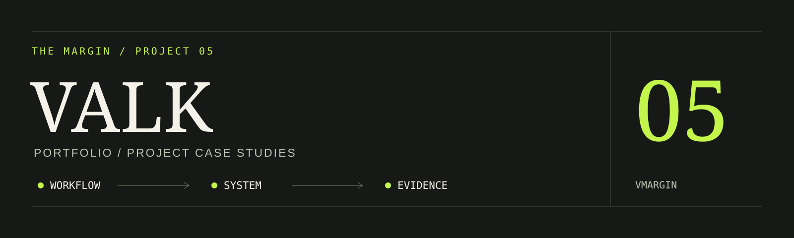

# Valk: Developer Portfolio

**Project case studies built around actual interfaces, workflows, and engineering decisions.**

A static React and TypeScript portfolio for Valkenburgh Margin, presenting junior Java, backend, and full-stack project work.

[Published portfolio](https://vmargin.github.io/) · [GitHub profile](https://github.com/vmargin)

## What the site contains

- Direct, reloadable case-study pages for CASH-G Web, ARCTIC, and AssetHub.
- Real application screenshots with capture context and evidence limits.
- Three project showcase films with card-level watch actions and players before each case-study gallery. Lightweight posters load first; video and sound start only after a watch action.
- Workflow and architecture views, contribution boundaries, source links, and project decisions.
- About, technologies, education/training, contact links, and unchanged supplied résumé/completion PDFs.
- Persistent light/dark appearance, motion preferences, keyboard-accessible navigation, and screenshot dialogs.

The case studies distinguish the hand-coded Java desktop foundation from the AI-assisted CASH-G web adaptation, and distinguish the original AssetHub from later assisted redesigns. They do not claim unverified adoption or business impact.

## Run locally

Use Node.js 24:

```powershell
git clone https://github.com/vmargin/vmargin.github.io.git
cd vmargin.github.io
npm ci
npm run dev
```

Development: http://127.0.0.1:5176. Run `npm run build`, then `npm run preview` for the production preview at http://127.0.0.1:4176.

## Content and publication

`src/data/portfolio.json` owns profile/project descriptions, contributions, galleries, and training details. Source portraits and landscape artwork live in `assets/source/`; `scripts/prepare-portfolio-assets.mjs` creates derivatives. [Evidence sources](docs/evidence-sources.md) explain the captures and credential boundaries.

The build typechecks, bundles the site, validates content, and prerenders home and project routes. It generates discovery and fallback files. The **Publish Valk** GitHub Actions workflow publishes `main` to GitHub Pages and prepares canonical/discovery URLs for https://vmargin.github.io/. The original hosted Site configuration is retained separately; its canonical origin in source data is intentional and is rewritten for the Pages output.

## Verify

```powershell
npm run typecheck
npm run verify:content
npm run build:github-pages
npm run format:check
```

Browser checks require Chromium and a running preview server:

```powershell
npx playwright install chromium
npm run verify:browser
npm run verify:latest
npm run verify:portrait
npm run verify:bulb
npm run verify:showcases
```

`PORTFOLIO_URL` and `CHROMIUM_PATH` can override the preview address and browser executable. Historical results are in [verification](docs/verification.md) and [the October 21 audit](docs/latest-update-audit-2026-10-21.md). Some raw browser artifacts are intentionally ignored and are not distributed with the source.

## Contribution and assets

The site presents my work and contribution boundaries; the design and implementation process includes AI assistance. Supplied photographs and documents retain their recorded provenance. Technology-icon notices remain with the local assets. [Historical hero-pair material](assets/hero-pair/README.md) documents an earlier design rather than the current layout.

---

[More projects](https://github.com/vmargin) · [Portfolio](https://vmargin.github.io/) · [LinkedIn](https://www.linkedin.com/in/vmargin/)
